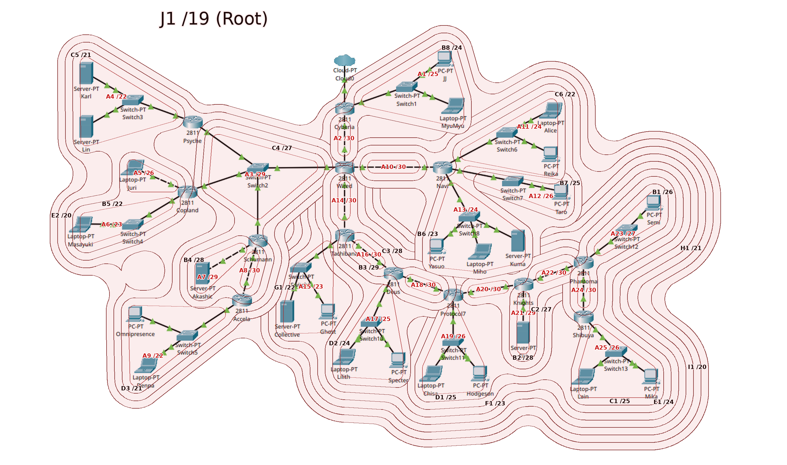

# The Wired Expansion — Cisco Packet Tracer (CIDR)

Pengerjaan soal shift Modul 4 Komdat Jarkom 2026, kelompok K-46, pada Cisco Packet Tracer.
Subnetting di sini memakai **CIDR**, sehingga GNS3 memakai VLSM.

| | |
|---|---|
| Prefix IP | `192.234` |
| Root | `192.234.0.0/19` (netmask `255.255.224.0`) |
| Jumlah subnet | 25 (A1–A25) |
| Total IP dibutuhkan | 2814 |
| Routing | 24 static route |

## Isi folder

- [cisco.pkt](cisco.pkt) — file topologi yang didemokan.
- [perhitungan.md](perhitungan.md) — seluruh perhitungan: labelling subnet, penggabungan, pohon CIDR, pembagian IP, alokasi IP interface, dan static route.
- [subnetting.png](subnetting.png) — topologi dengan lingkaran subnet dan blok gabungan CIDR.

## Topologi

Terdiri dari 52 device dan 51 kabel:

- 13 router 2811
- 13 Switch-PT
- 25 host (PC-PT, Laptop-PT, Server-PT)
- 1 Cloud-PT, hanya terhubung ke Cyberia

Router 2811 bawaan hanya punya 2 port.
Router yang butuh lebih dari 2 port dipasangi `NM-2FE2W` pada slot 1, yang menambah `Fa1/0` dan `Fa1/1`.
Psyche, Accela, dan Shibuya tidak memerlukan modul ini.

Setiap node host mewakili seluruh host yang tertulis pada gambar topologi, jadi satu node mendapat satu IP.

## Ringkasan pembagian

Sisi kiri Wired memakai `192.234.0.0/20`, sedangkan sisi kanan dan Cyberia memakai `192.234.16.0/20`.

| Blok | Isi |
|---|---|
| `192.234.0.0/21` | Psyche, Copland |
| `192.234.8.0/21` | Schumann, Accela, dan segmen bersama Switch2 |
| `192.234.16.0/22` | Navi |
| `192.234.20.0/22` | Tachibana ke bawah, sampai Shibuya |
| `192.234.24.0/24` | Cyberia |

Blok-blok ini mengikuti arah routing, sehingga tiap router cukup punya satu route untuk tiap tetangga di arah bawah, ditambah satu default route ke arah Cyberia.

## Gambar subnetting

Label merah (A1–A25) menandai subnet. Label hitam (B1–J1) menandai blok hasil penggabungan, dari tahap I sampai IX di [perhitungan.md](perhitungan.md). Makin dalam lapisannya, makin awal blok itu digabung. Link Cloud–Cyberia berada di luar root karena tidak dihitung sebagai subnet.



## Catatan

- Link Cloud–Cyberia tidak dihitung sebagai subnet, mengikuti template spreadsheet. `Cyberia Fa0/0` aktif tanpa IP, dan Cloud tidak bisa di-ping.
- Ping pertama jarak jauh bisa timeout karena ARP belum terisi. Ulangi sekali.

## Cara menguji

1. Buka `cisco.pkt` di Cisco Packet Tracer.
2. Tunggu semua link hijau, atau tekan Fast Forward Time.
3. Jalankan ping antarhost, misalnya dari Lain ke Karl:

   ```
   ping 192.234.0.2
   ```

Hasil uji yang sudah dilakukan ada di bagian Pemeriksaan pada [perhitungan.md](perhitungan.md).
