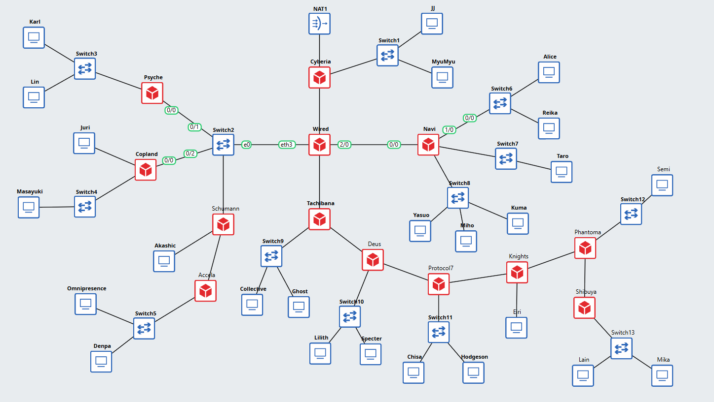
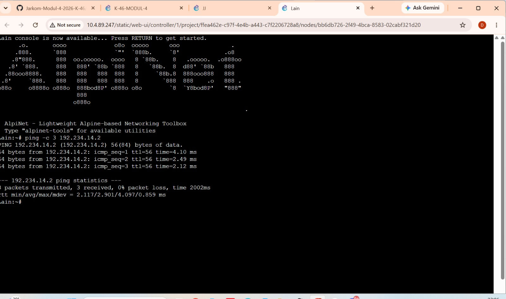
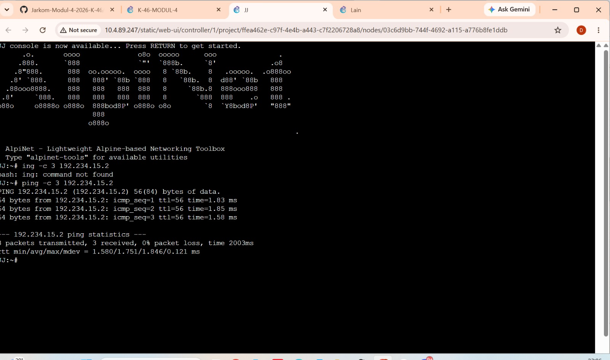
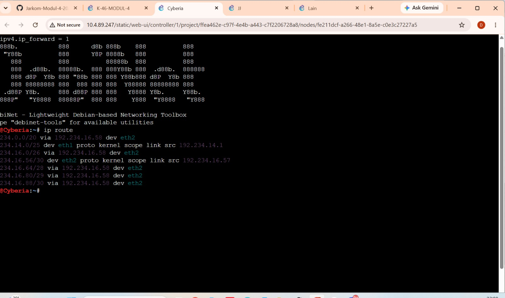
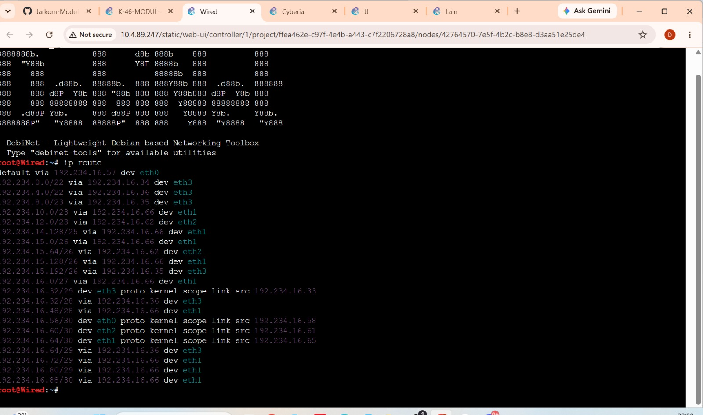
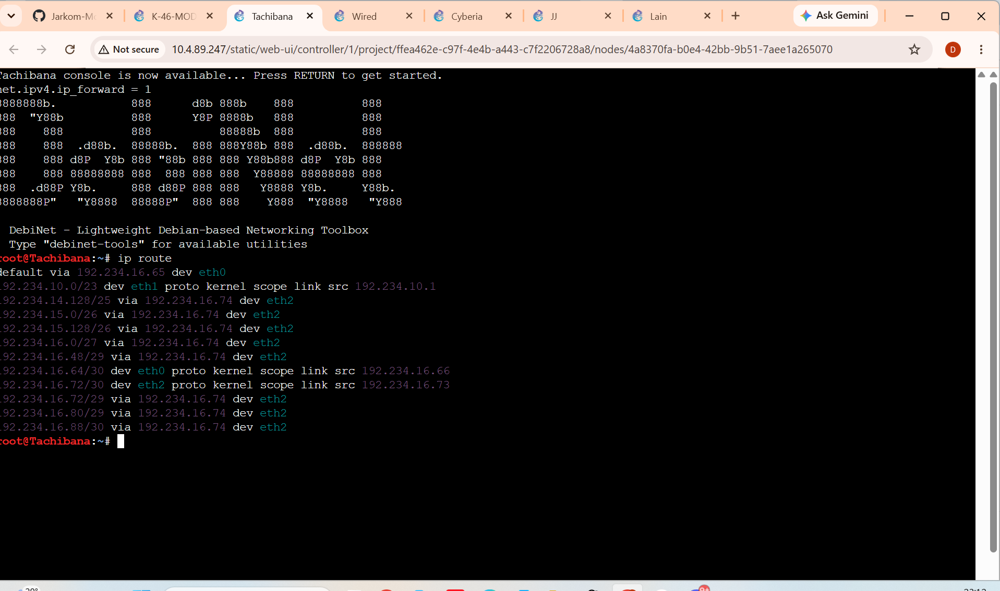

# The Wired Expansion — GNS3 (VLSM)

Laporan Praktikum Modul 4 Komdat Jarkom 2026, kelompok **K-46**. Subnetting pada GNS3 menggunakan **VLSM**. Bagian Cisco Packet Tracer menggunakan **CIDR**. [Laporan Packet Tracer](../cpt-cidr/README.md)

| Item | Keterangan |
|---|---|
| Project GNS3 | `K-46-MODUL-4` |
| Prefix IP | `192.234` |
| Blok induk | `192.234.0.0/19` (`255.255.224.0`) |
| Jumlah subnet | 25 (A1–A25) |
| Kebutuhan IP | 2.814 IP host dan interface router |
| Total ukuran blok subnet | 4.188 alamat, termasuk Network ID dan broadcast |
| Routing | Static routing dengan IPv4 forwarding pada router |

## Topologi

Topologi terdiri dari **52 perangkat dan 51 kabel**. Perangkatnya terdiri dari 13 router, 13 switch, 25 node host, dan 1 NAT. NAT1 terhubung langsung ke Cyberia. Setiap node host di GNS3 mendapat satu IP untuk mewakili kelompok host yang tertera pada gambar soal. [Gambar topologi soal](https://drive.google.com/file/d/1B_O8eiCmmFBcvyT-J5YCsoAIxY28Wwj-/view)



## Perhitungan VLSM

Kebutuhan IP suatu subnet dihitung dari jumlah host pada gambar ditambah jumlah interface router yang terhubung ke subnet tersebut. Port switch pada topologi ini tidak diberi IP. Contohnya, A6 membutuhkan `700 (Karl) + 180 (Lin) + 1 (Psyche) = 881 IP`. Setelah menambah dua alamat untuk Network ID dan broadcast, kebutuhan bloknya menjadi 883 alamat. Pangkat dua terkecil yang memenuhi kebutuhan itu adalah `2^10 = 1.024`, sehingga prefix A6 adalah `32 − 10 = /22`.

Ukuran 25 blok setelah pembulatan berjumlah 4.188 alamat. Blok `/20` menyediakan 4.096 alamat, sehingga alokasi dimulai dari `192.234.0.0/19` yang menyediakan 8.192 alamat.

Pohon VLSM membagi blok induk menjadi dua blok sama besar setiap kali prefix bertambah satu. Cabang di bawah memperlihatkan cara mendapatkan dua blok `/22` untuk A6 dan A11.

```text
192.234.0.0/19
├── 192.234.0.0/20
│   ├── 192.234.0.0/21
│   │   ├── 192.234.0.0/22  A6
│   │   └── 192.234.4.0/22  A11
│   └── 192.234.8.0/21      Dibagi lagi untuk subnet berikutnya
└── 192.234.16.0/20         Dibagi lagi untuk subnet kecil dan link router
```

Netmask `/22` adalah `255.255.252.0`. Oktet ketiga bertambah `256 − 252 = 4` setiap pindah blok. A6 dimulai dari `192.234.0.0`, jadi batas blok berikutnya adalah `192.234.4.0`. Broadcast A6 adalah satu alamat sebelum batas itu, yaitu `192.234.3.255`. Rentang IP yang bisa dipakai adalah `192.234.0.1` sampai `192.234.3.254`. A11 mulai di `192.234.4.0`.

Pembagian dimulai dari blok terbesar, sedangkan tabel disusun menurut nomor subnet agar mudah dicocokkan dengan topologi. Kolom **Jumlah IP** menunjukkan kebutuhan host dan interface router sebelum penambahan Network ID dan broadcast. [Tabel kebutuhan IP](https://docs.google.com/spreadsheets/d/1rVodUBcBINJPgOZ-5xVqw0H3jL9A58Wp/edit?gid=1199523220#gid=1199523220) · [Tabel pembagian IP VLSM](https://docs.google.com/spreadsheets/d/1rVodUBcBINJPgOZ-5xVqw0H3jL9A58Wp/edit?gid=916994593#gid=916994593)

### Rute dan kebutuhan IP

Kolom **Rute** menunjukkan perangkat yang berada di satu subnet. Kolom **Jumlah IP** menghitung kebutuhan host dan interface router pada subnet tersebut.

| Subnet | Rute | Jumlah IP | Prefix |
|---|---|---:|---|
| A1 | Cyberia → Switch1 → JJ, MyuMyu | 126 | `/25` |
| A2 | Cyberia → Wired | 2 | `/30` |
| A3 | Wired → Switch2 → Psyche, Copland, Schumann | 4 | `/29` |
| A4 | Wired → Navi | 2 | `/30` |
| A5 | Wired → Tachibana | 2 | `/30` |
| A6 | Psyche → Switch3 → Karl, Lin | 881 | `/22` |
| A7 | Copland → Juri | 32 | `/26` |
| A8 | Copland → Switch4 → Masayuki | 301 | `/23` |
| A9 | Schumann → Akashic | 4 | `/29` |
| A10 | Schumann → Accela | 2 | `/30` |
| A11 | Accela → Switch5 → Omnipresence, Denpa | 514 | `/22` |
| A12 | Navi → Switch6 → Alice, Reika | 254 | `/24` |
| A13 | Navi → Switch7 → Taro | 58 | `/26` |
| A14 | Navi → Switch8 → Yasuo, Miho, Kuma | 143 | `/24` |
| A15 | Tachibana → Switch9 → Collective, Ghost | 267 | `/23` |
| A16 | Tachibana → Deus | 2 | `/30` |
| A17 | Deus → Switch10 → Lilith, Specter | 99 | `/25` |
| A18 | Deus → Protocol7 | 2 | `/30` |
| A19 | Protocol7 → Switch11 → Chisa, Hodgeson | 33 | `/26` |
| A20 | Protocol7 → Knights | 2 | `/30` |
| A21 | Knights → Eiri | 3 | `/29` |
| A22 | Knights → Phantoma | 2 | `/30` |
| A23 | Phantoma → Switch12 → Semi | 15 | `/27` |
| A24 | Phantoma → Shibuya | 2 | `/30` |
| A25 | Shibuya → Switch13 → Lain, Mika | 62 | `/26` |

### Pembagian IP VLSM

Network ID dan broadcast menandai batas blok. Rentang IP host berisi alamat yang bisa dipakai perangkat di dalam blok itu.

| Subnet | Network ID / prefix | Netmask | Broadcast | Rentang IP host |
|---|---|---|---|---|
| A1 | `192.234.14.0/25` | `255.255.255.128` | `192.234.14.127` | `192.234.14.1` – `192.234.14.126` |
| A2 | `192.234.16.56/30` | `255.255.255.252` | `192.234.16.59` | `192.234.16.57` – `192.234.16.58` |
| A3 | `192.234.16.32/29` | `255.255.255.248` | `192.234.16.39` | `192.234.16.33` – `192.234.16.38` |
| A4 | `192.234.16.60/30` | `255.255.255.252` | `192.234.16.63` | `192.234.16.61` – `192.234.16.62` |
| A5 | `192.234.16.64/30` | `255.255.255.252` | `192.234.16.67` | `192.234.16.65` – `192.234.16.66` |
| A6 | `192.234.0.0/22` | `255.255.252.0` | `192.234.3.255` | `192.234.0.1` – `192.234.3.254` |
| A7 | `192.234.15.192/26` | `255.255.255.192` | `192.234.15.255` | `192.234.15.193` – `192.234.15.254` |
| A8 | `192.234.8.0/23` | `255.255.254.0` | `192.234.9.255` | `192.234.8.1` – `192.234.9.254` |
| A9 | `192.234.16.40/29` | `255.255.255.248` | `192.234.16.47` | `192.234.16.41` – `192.234.16.46` |
| A10 | `192.234.16.68/30` | `255.255.255.252` | `192.234.16.71` | `192.234.16.69` – `192.234.16.70` |
| A11 | `192.234.4.0/22` | `255.255.252.0` | `192.234.7.255` | `192.234.4.1` – `192.234.7.254` |
| A12 | `192.234.12.0/24` | `255.255.255.0` | `192.234.12.255` | `192.234.12.1` – `192.234.12.254` |
| A13 | `192.234.15.64/26` | `255.255.255.192` | `192.234.15.127` | `192.234.15.65` – `192.234.15.126` |
| A14 | `192.234.13.0/24` | `255.255.255.0` | `192.234.13.255` | `192.234.13.1` – `192.234.13.254` |
| A15 | `192.234.10.0/23` | `255.255.254.0` | `192.234.11.255` | `192.234.10.1` – `192.234.11.254` |
| A16 | `192.234.16.72/30` | `255.255.255.252` | `192.234.16.75` | `192.234.16.73` – `192.234.16.74` |
| A17 | `192.234.14.128/25` | `255.255.255.128` | `192.234.14.255` | `192.234.14.129` – `192.234.14.254` |
| A18 | `192.234.16.76/30` | `255.255.255.252` | `192.234.16.79` | `192.234.16.77` – `192.234.16.78` |
| A19 | `192.234.15.128/26` | `255.255.255.192` | `192.234.15.191` | `192.234.15.129` – `192.234.15.190` |
| A20 | `192.234.16.80/30` | `255.255.255.252` | `192.234.16.83` | `192.234.16.81` – `192.234.16.82` |
| A21 | `192.234.16.48/29` | `255.255.255.248` | `192.234.16.55` | `192.234.16.49` – `192.234.16.54` |
| A22 | `192.234.16.84/30` | `255.255.255.252` | `192.234.16.87` | `192.234.16.85` – `192.234.16.86` |
| A23 | `192.234.16.0/27` | `255.255.255.224` | `192.234.16.31` | `192.234.16.1` – `192.234.16.30` |
| A24 | `192.234.16.88/30` | `255.255.255.252` | `192.234.16.91` | `192.234.16.89` – `192.234.16.90` |
| A25 | `192.234.15.0/26` | `255.255.255.192` | `192.234.15.63` | `192.234.15.1` – `192.234.15.62` |

## Routing

Host menggunakan IP router di subnetnya sebagai gateway. JJ (`192.234.14.2`) memakai Cyberia (`192.234.14.1`) di A1. Mika (`192.234.15.3`) memakai Shibuya (`192.234.15.1`) di A25. Untuk komunikasi lintas subnet, router mengaktifkan IPv4 forwarding dan menggunakan static route ke jaringan tujuan. Jalur balik juga harus tersedia.

Saat JJ mengirim paket ke Mika, Cyberia meneruskannya ke Wired. Paket kemudian melewati Tachibana, Deus, Protocol7, Knights, dan Phantoma sebelum sampai ke Shibuya. Shibuya meneruskan paket ke Mika melalui LAN A25. Saat Mika membalas, Shibuya memakai default route ke Phantoma untuk mulai mengirim paket kembali ke A1.

## Cara menguji

1. Buka console **Cyberia**, **Wired**, dan **Tachibana** satu per satu, lalu jalankan `ip route` untuk melihat rute aktif dan next hop masing-masing.
2. Buka console **JJ**, lalu jalankan `ping -c 3 192.234.15.3`.
3. Buka console **Mika**, lalu jalankan `ping -c 3 192.234.14.2`.
4. Cek jumlah balasan dan persentase packet loss untuk kedua arah. Jika muncul `Destination Net Unreachable`, gunakan `ip route get <IP tujuan>` pada gateway yang mengirim pesan itu untuk memeriksa rutenya.

## Hasil pengujian

### Ping internal setelah konfigurasi routing

Ping antara A1 dan A25 berhasil dua arah untuk pasangan JJ dan Mika serta Lain dan JJ. Pada tiap screenshot, tiga baris `bytes from` menunjukkan balasan dari IP tujuan. Angka `3 received` di akhir menunjukkan semua paket uji mendapat balasan.

| Arah | Perintah di perangkat sumber | Paket diterima | Packet loss |
|---|---|---:|---:|
| JJ → Mika | `ping -c 3 192.234.15.3` | 3 dari 3 | 0% |
| Mika → JJ | `ping -c 3 192.234.14.2` | 3 dari 3 | 0% |
| Lain → JJ | `ping -c 3 192.234.14.2` | 3 dari 3 | 0% |
| JJ → Lain | `ping -c 3 192.234.15.2` | 3 dari 3 | 0% |





[Bukti tambahan JJ → Mika](images/ping-jj-ke-mika-lulus.png) · [Bukti tambahan Mika → JJ](images/ping-mika-ke-jj-lulus.png)

<details>
<summary>Diagnosis awal sebelum konfigurasi routing</summary>

### Ping awal antar-subnet

| Sumber | Tujuan | Hasil di screenshot |
|---|---|---|
| JJ (`192.234.14.2`) | Mika (`192.234.15.3`) | `Destination Net Unreachable` dari Cyberia (`192.234.14.1`). 0 dari 3 paket diterima. |
| Mika (`192.234.15.3`) | JJ (`192.234.14.2`) | `Destination Net Unreachable` dari Shibuya (`192.234.15.1`). 0 dari 3 paket diterima. |

### Pemeriksaan gateway sebelum penambahan rute

Di kedua gateway, `/proc/sys/net/ipv4/ip_forward` bernilai `1`, tetapi `ip route get` ke alamat host tujuan menampilkan `Network is unreachable`. Jadi forwarding sudah aktif dan tabel routing belum punya jalur ke tujuan yang diuji.

### Pemeriksaan gateway setelah penambahan rute

| Router | Rute yang dipasang pada screenshot | Hasil `ip route get` |
|---|---|---|
| Cyberia | `192.234.0.0/20 via 192.234.16.58 dev eth2` | Tujuan `192.234.15.3` keluar melalui `eth2` menuju `192.234.16.58` (Wired). |
| Shibuya | `default via 192.234.16.89 dev eth0` | Tujuan `192.234.14.2` keluar melalui `eth0` menuju `192.234.16.89` (Phantoma). |

</details>

### Tabel routing Cyberia, Wired, dan Tachibana

Perintah `ip route` menampilkan rute yang aktif. Baca setiap baris dari kiri ke kanan. Prefix di awal menunjukkan jaringan tujuan, `via` menunjukkan IP router berikutnya, dan `dev` menunjukkan interface untuk mengirim paket. Baris `proto kernel scope link` menunjukkan jaringan yang terhubung langsung. Router memakai rute dengan prefix paling spesifik yang cocok, lalu memakai `default` jika tidak ada rute yang lebih spesifik.

| Router | Default route | Contoh rute internal dari screenshot |
|---|---|---|
| Cyberia | Tidak tercantum pada hasil `ip route` ini. | `192.234.0.0/20 via 192.234.16.58 dev eth2` menuju Wired. |
| Wired | `default via 192.234.16.57 dev eth0` menuju Cyberia. | `192.234.12.0/23 via 192.234.16.62 dev eth2` merangkum dua subnet LAN di cabang Navi. |
| Tachibana | `default via 192.234.16.65 dev eth0` menuju Wired. | `192.234.15.0/26 via 192.234.16.74 dev eth2` menuju subnet LAN Shibuya melalui Deus. |







Contoh ringkasan rute ada di Wired. Jaringan `192.234.12.0/24` dan `192.234.13.0/24` sama-sama menuju Navi, sehingga Wired cukup mencatat `192.234.12.0/23` lewat `192.234.16.62`. Navi meneruskan paket ke LAN tujuan yang terhubung langsung padanya.

### Koneksi ke luar melalui NAT

Pada percobaan terakhir, `ping -c 3 8.8.8.8` dari Lain belum mendapat balasan. Uji koneksi luar ini dicatat terpisah dari ping internal.
